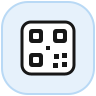
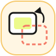
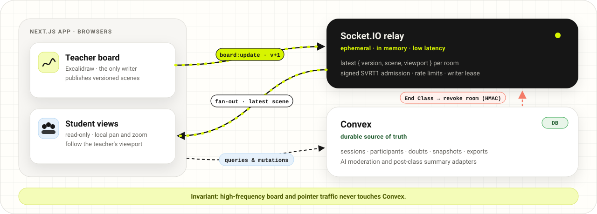

<p align="center">
  
</p>

<p align="center">
  <b>Live classroom whiteboarding.</b> The teacher writes on a stylus-first canvas, every student watches the same board in real time, explores it at their own pace, and asks doubts anonymously.
</p>

<p align="center">
  
  
  
  
  
  
</p>

---

## How a class works

<p align="center">
  
</p>

## Features

<table>
  <tr>
    <td width="50%" valign="top">
      <br />
      <b>Live teacher board</b><br />
      A stylus-first Excalidraw canvas. Strokes stream to every student in small batches, and only the teacher can edit.
    </td>
    <td width="50%" valign="top">
      <br />
      <b>Join in seconds</b><br />
      Students scan a QR code or type a six-character room code. No student accounts, nothing to install.
    </td>
  </tr>
  <tr>
    <td width="50%" valign="top">
      <br />
      <b>Follow or roam</b><br />
      Students pan and zoom without disturbing anyone, then return to the teacher's viewport in one tap.
    </td>
    <td width="50%" valign="top">
      <br />
      <b>Anonymous, moderated doubts</b><br />
      Questions reach the teacher without a name attached, after rate limits and AI moderation screen them.
    </td>
  </tr>
  <tr>
    <td width="50%" valign="top">
      <br />
      <b>The lesson stays</b><br />
      End Class saves the final board, and a post-class AI summary gives students notes to come back to.
    </td>
    <td width="50%" valign="top">
      <br />
      <b>Prepared boards and blocks</b><br />
      Open a class on a saved template, or drop in Mermaid, code, math and automata blocks as editable shapes.
    </td>
  </tr>
</table>

## Architecture

<p align="center">
  
</p>

Three runtimes, deliberately separated:

| Runtime | Role |
| --- | --- |
| **Next.js App Router** (`app/`, `components/`, `lib/`) | UI: landing page, teacher and student board shells |
| **Socket.IO relay** (`socket-server/`) | Ephemeral, low-latency transport for live scenes and the teacher's viewport |
| **Convex** (`convex/`) | Durable source of truth: sessions, participants, doubts, snapshots, exports, quizzes |

- **One writer, no CRDT.** Only the teacher edits, so every update carries a monotonic `boardVersion` and receivers apply only newer ones.
- **Signed admission.** Sockets join with a short-lived HMAC `SVRT1` room token. Role comes from the token, never from a client payload, and tokens renew in band without dropping the connection.
- **Self-healing sync.** Every publish is acknowledged, the teacher republishes after a reconnect or relay restart, and an ended class shows a clear terminal state.
- **AI behind adapters.** Moderation and post-class summaries run only in Convex internal actions, through provider-agnostic adapters.

The wire protocol lives in [`shared/protocol/socket.ts`](shared/protocol/socket.ts): one Zod schema per event, shared by both sides.

## Getting started

You need Node.js 22+, npm, and a [Convex](https://convex.dev) account.

```bash
npm install
cp .env.example .env.local
```

Set `SOCKET_INTERNAL_SECRET` in `.env.local` to a random string of at least 32 characters. [`.env.example`](.env.example) documents every other variable.

```bash
npx convex dev      # terminal 1: Convex dev deployment
npm run dev:all     # terminal 2: Next.js on :3000 and the relay on :4001
```

Open <http://localhost:3000>, start a class as the teacher, and join from another tab with the room code. Local teacher mode and production settings are covered in [`docs/20_DEPLOYMENT_ENVIRONMENT.md`](docs/20_DEPLOYMENT_ENVIRONMENT.md).

## Scripts

| Command | What it does |
| --- | --- |
| `npm run dev` | Next.js only (:3000) |
| `npm run dev:socket` | Socket.IO relay only (:4001) |
| `npm run dev:all` | Both, concurrently |
| `npm run lint` | ESLint over app, components, convex, shared, tests and socket-server |
| `npm run typecheck` | Root and socket-server `tsc --noEmit` |
| `npm run test:all` | Root and socket-server Vitest suites |
| `npm run verify` | Lint, typecheck, all tests and a production build. Run it before calling work done |

## Project layout

```text
app/             Next.js routes: landing, /teacher, /join, /student/[sessionId]
components/      UI: board canvas and sync hooks, room controls, landing
convex/          Durable backend, one file per domain; privileged work in internal/
socket-server/   Socket.IO relay (npm workspace with its own tsconfig and tests)
shared/          Wire protocol (Zod schemas) and shared limits
lib/             Helpers: AI adapters, board blocks, sync logic, errors
docs/            Specification set; start at docs/00_START_HERE.md
tests/           Root Vitest suites (relay tests live in socket-server/test)
```

## Contributing

- [`AGENTS.md`](AGENTS.md) holds the non-negotiable product and engineering rules. Read it first.
- [`docs/00_START_HERE.md`](docs/00_START_HERE.md) indexes the specs, and [`docs/25_ACCEPTANCE_TESTS.md`](docs/25_ACCEPTANCE_TESTS.md) is the definition of done.
- [`CLAUDE.md`](CLAUDE.md) covers commands, architecture and code navigation for AI coding agents.
- Don't silently expand scope. If a change conflicts with the specs, raise it instead of redesigning.

<p align="center">
  
</p>
